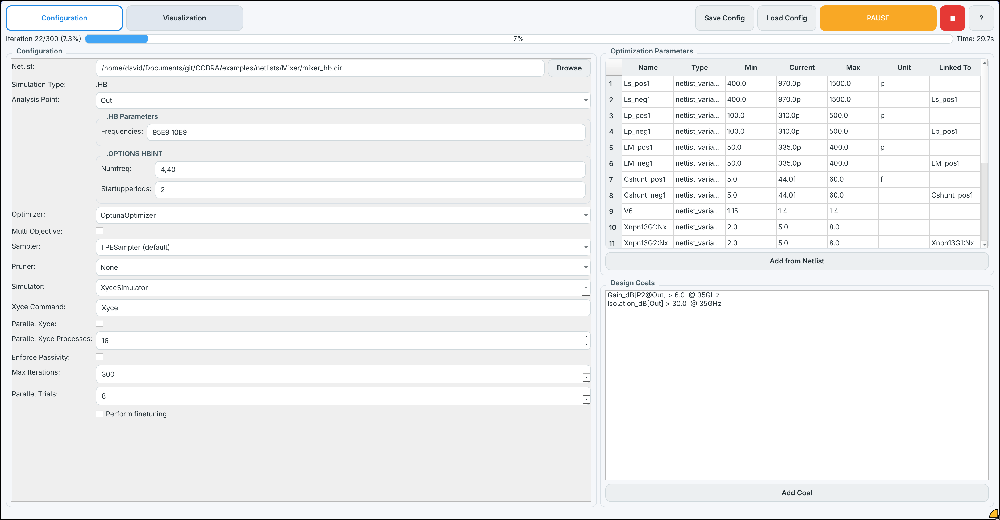
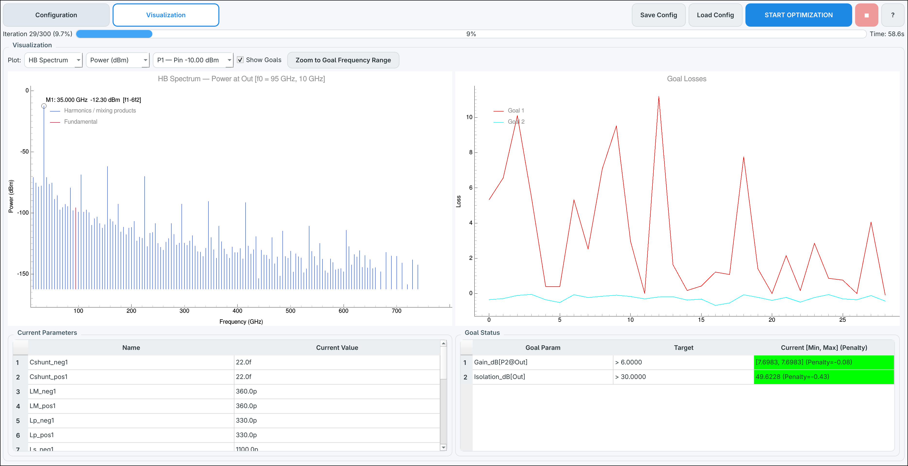
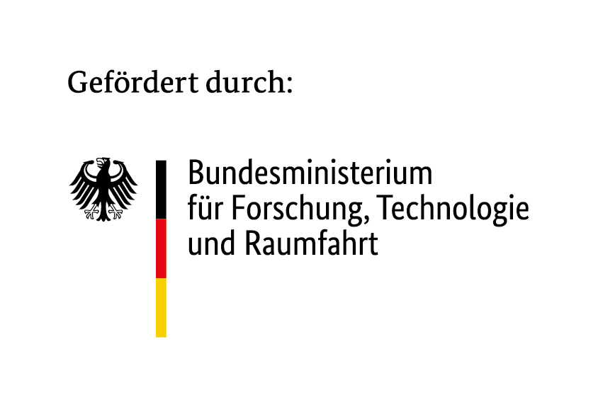

# COBRA - A Circuit-Level Open-Source Based RFIC AI-Assisted Optimizer
[](https://di-passionate.github.io/COBRA/)
[](https://github.com/DI-PASSIONATE/COBRA/blob/main/LICENSE)
[](https://github.com/DI-PASSIONATE/COBRA/blob/main/pyproject.toml)
[](https://pypi.org/project/cobra-rfic/)
[](https://github.com/DI-PASSIONATE/COBRA/actions/workflows/tests.yml)
[](https://github.com/DI-PASSIONATE/COBRA/stargazers)

©2026 

Gianluca Simone\*, David Lurz\*, Martin Grund\*, Fabian Schneider°, Michael Loose\*, Sascha Breun\*, Manuel Koch\*, Robert Weigel\*, Norman Franchi\*

\* Institute for Smart Electronics and Systems (LITES), Friedrich-Alexander-Universität (FAU), Erlangen-Nürnberg, Germany

° Chair of Integrated Electronic Systems, Otto-von-Guericke-University Magdeburg, Germany

[Paper](https://doi.org/10.1109/SBCCI69725.2026.11706804) | [Documentation](https://di-passionate.github.io/COBRA/) | [BibTex](#cite-this-work)

**COBRA** is an open-source EDA tool for AI-assisted RFIC (RF integrated circuit) design. It optimizes a circuit towards your design goals: surrogate models built by [ORCA](https://github.com/DI-PASSIONATE/ORCA) predict the passives' S-parameters in milliseconds, [Xyce](https://xyce.sandia.gov/) or [VACASK](https://codeberg.org/arpadbuermen/VACASK) simulates the circuit, and [Optuna](https://optuna.org) proposes the next design.





> [!NOTE]
> COBRA is under active development. If you run into a problem or have a question, please [open an issue](https://github.com/DI-PASSIONATE/COBRA/issues).

## Key Features

- **Surrogates and fixed components** in one circuit: ORCA's ONNX models for geometries to optimize, Touchstone files for everything else.
- **Goals from many analyses**: S-parameters, inductance, Q and coupling, noise figure, [harmonic balance](https://di-passionate.github.io/COBRA/advanced/harmonic-balance/) and [transient](https://di-passionate.github.io/COBRA/advanced/transient/) power, gain and isolation, or your own formula over them.
- **Geometry and circuit together**: optimize layout dimensions and netlist values in the same run.
- **EM verification**: simulate the result full-wave with [Palace](https://awslabs.github.io/palace/stable/) and [retune the circuit](https://di-passionate.github.io/COBRA/advanced/fine-tuning/) on it.
- **GUI, command line and Python**: GUI and command line share one JSON configuration.
- **Shared models**: browse and download surrogates from Hugging Face in the GUI.

## Installation

COBRA needs Python 3.11 to 3.13 and Xyce or [VACASK](https://di-passionate.github.io/COBRA/advanced/vacask/). It is published on PyPI as [`cobra-rfic`](https://pypi.org/project/cobra-rfic/); the import package and the command are called `cobra`.

```bash
pip install cobra-rfic             # or: uv tool install cobra-rfic
pip install "cobra-rfic[orca]"     # with ORCA, for EM fine-tuning
cobra doctor                       # check simulators and packages
```

From source, with [uv](https://docs.astral.sh/uv/):

```bash
git clone https://github.com/DI-PASSIONATE/COBRA
cd COBRA
uv sync
uv run pytest
```

See the [installation guide](https://di-passionate.github.io/COBRA/setup/) for the external tools and other setups.

## Quickstart

Start the GUI, load a netlist (e.g. from [Qucs-S](https://qucs-s-help.readthedocs.io/en/latest/)), pick a model per component, add goals and parameters, and run:

```bash
cobra
```

Or run without the GUI:

```bash
cobra init design.cir --model X1=models/coil.onnx -o cobra_config.json
cobra parse cobra_config.json      # check it
cobra run cobra_config.json
```

Or from Python, as in [examples/main.py](https://github.com/DI-PASSIONATE/COBRA/blob/main/examples/main.py). Each run writes its parameters, history and simulation results to `results/<timestamp>_<netlist>/`.

## How It Works

Each trial:

1. The optimizer proposes geometry and netlist values.
2. The surrogates predict each component's S-parameters.
3. Vector fitting turns them into subcircuits a SPICE simulator can use.
4. Xyce or VACASK runs every analysis the goals need.
5. Each goal's miss becomes a penalty, from which the optimizer proposes the next trial.

## Documentation

| Topic | Page |
| --- | --- |
| First run | [Quickstart](https://di-passionate.github.io/COBRA/getting-started/quickstart/) |
| Interfaces | [GUI](https://di-passionate.github.io/COBRA/user-guide/gui/), [command line](https://di-passionate.github.io/COBRA/user-guide/cli/), [Python](https://di-passionate.github.io/COBRA/user-guide/scripting/) |
| Goals, parameters, optimizers and simulators | [JSON configuration](https://di-passionate.github.io/COBRA/user-guide/configuration/) |
| Examples | [Examples](https://di-passionate.github.io/COBRA/user-guide/examples/) |
| Problems | [Troubleshooting](https://di-passionate.github.io/COBRA/advanced/troubleshooting/), [FAQ](https://di-passionate.github.io/COBRA/advanced/faq/) |

## Cite This Work
If you use COBRA in your research, please cite our [SBCCI 2026 paper](https://doi.org/10.1109/SBCCI69725.2026.11706804):

```
@INPROCEEDINGS{2026_COBRA,
  author={Simone, Gianluca and Lurz, David and Grund, Martin and Schneider, Fabian and Loose, Michael and Breun, Sascha and Koch, Manuel and Weigel, Robert and Franchi, Norman},
  booktitle={2026 39th SBC/SBMicro/IEEE Symposium on Integrated Circuits and Systems Design (SBCCI)},
  title={{COBRA: An AI-Assisted Circuit-Level Optimizer for Open Source Based RFIC Design}},
  year={2026},
  month={aug},
  pages={1--5},
  organization={IEEE},
  doi={10.1109/SBCCI69725.2026.11706804},
  keywords={artificial intelligence, design automation, EDA, neural network, open-source, optimization, Palace, Qucs-S, radio frequency integrated circuit, surrogate model, Xyce}
}
```

## Acknowledgements
This work was supported by the Bundesministerium für Forschung, Technologie und Raumfahrt (BMFTR) under the DI-PASSIONATE project. We appreciate the scientific support and HPC resources provided by the Erlangen National High Performance Computing Center (NHR@FAU) of the Friedrich-Alexander-Universität Erlangen-Nürnberg (FAU). The hardware is funded by the German Research Foundation (DFG).

We thank our colleagues in the LITES institute for their feedback and support during development. Special thanks to the open-source community for providing the tools and libraries that made this project possible, including but not limited to:

- [gdsfactory](https://github.com/gdsfactory/gdsfactory)
- [gds2palace](https://github.com/VolkerMuehlhaus/gds2palace_ihp_sg13g2)
- [setupEM](https://github.com/VolkerMuehlhaus/setupEM)
- [Palace](https://github.com/awslabs/palace)
- [PyTorch](https://github.com/pytorch/pytorch)
- [ONNX](https://github.com/onnx/onnx)
- [scikit-rf](https://github.com/scikit-rf/scikit-rf)
- [OpenStack](https://opendev.org/openstack)

<table width="100%">
  <tr>
    <td align="left" width="50%">
      <a href="https://www.lites.tf.fau.de/" target="_blank">
        
      </a>
    </td>
    <td align="right" width="50%">
      <a href="https://www.elektronikforschung.de/projekte/di-passionate" target="_blank">
        
      </a>
    </td>
  </tr>
</table>
