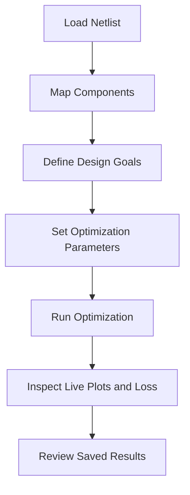

# GUI Mode

The COBRA GUI is launched with:

```bash
cobra
```

## What You Can Configure

The configuration panel is split into sections: *Netlist and models*, *Analyses*,
*Optimizer*, *Simulator* and *Fine-tuning*. Click a section's title to collapse or
expand it; a collapsed section shows a one-line summary of its settings, e.g.
"OptunaOptimizer · up to 500 iterations · 4 parallel trials". Settings whose defaults
suit most runs (the Optuna pruner and seed, VACASK's fit settings, the Palace process
count, the retune's range) sit behind the section's *Advanced* fold. Fine-tuning is
switched on with the *Enabled* box in its header, which opens its settings.

- Netlist source
- Component-to-model mapping (`.onnx` or `.sNp`). Hover over the model field to see what
  an ONNX model declares: its band, trained ranges, feasibility constraints and guarantees
- Simulator: `XyceSimulator` or `VacaskSimulator`. The netlist dialog accepts
  `*.sim`, `*.scs` and `*.spectre` files besides SPICE netlists. Switching the
  simulator re-reads the loaded netlist with that simulator's parser, and the goal
  list offers only goals the selected simulator can run (e.g. `NF` for VACASK)
- Subcircuit surrogate: the "Subcircuit surrogate" row lists the netlist's
  subcircuits as "name (N pins)"; **Use as surrogate** adds a model row for the
  selected one (its instances are replaced, see
  [VACASK Simulator](../advanced/vacask.md#style-2-xschem-netlists)) and
  **Clear** removes the selection. Loading a configuration restores subcircuit
  surrogates
- Analysis variants: further analyses of a type, each on the netlist with some
  values changed (e.g. the HB at another drive)
- Design goals (S-parameter and RF metrics, and expressions over other goals)
- Analysis point, when the run includes a Harmonic Balance or transient analysis
- Optimization parameters and ranges
- Iteration control and stop behavior
- Parallelism: either N independent trials or one N-rank MPI simulation
- Optional fine-tuning settings, including the retune after a Palace iteration that
  misses the goals (*Retune trials*, *Retune range (±%)*, *Retune min steps*; see
  [Fine-Tuning](../advanced/fine-tuning.md#retune-with-the-em-models-fixed))

## Appearance

The GUI ships two themes: **Sandbank** (light) and **Deepwater** (dark). By
default it follows the operating system's colour scheme and switches live when
the system changes. The theme button in the top-right corner cycles through
*system → light → dark*; the choice is stored in the COBRA settings
(`appearance/mode`) and restored on the next start.

## Typical GUI Flow



## Parallelism

The **Parallelism** row offers one choice and one process count:

- **Independent trials** — the recommended mode. `Processes` trials are
  evaluated at the same time, each in its own single-core simulation. This is
  saved as `parallel_trials`.
- **Parallel simulator (MPI)** — one trial at a time, each simulation on
  `Processes` MPI ranks (`parallel_xyce` and `parallel_xyce_processes`). Only
  worthwhile for very large netlists; it needs an MPI-enabled Xyce build.

The two modes compete for the same cores, so the GUI never enables both. A
configuration file that sets `parallel_trials` above 1 *and* `parallel_xyce`
is rejected when loaded into the GUI; headless runs still accept it with a
warning.

## Optimization Parameters

The parameter dialog sets a parameter's bounds, step, unit and link, and an
optional **Start value** (`initial_value`): the value the optimizer evaluates
first, for example a known design you want to retune. *None* lets the optimizer
choose. For an ONNX model input, the dialog takes the bounds, and the step of
an input such as whole turns, from the model's metadata.

The **Optimizer** row offers `OptunaOptimizer` (the default, a global search)
and `GradientDescentOptimizer`, a local search that runs one trial at a time.

## Design Goals in Practice

Use goal constraints with optional frequency ranges, for example:

- S11 <= -9 dB in `125-135ghz`
- -3 dB <= S21 <= 0 dB in `125-135ghz`
- `Power_dBm[Out]` >= 10 dB at `35ghz` (single spectral line of an HB run)

The goal dialog groups the parameters by the analysis that produces them (`.AC`, `.HB`, `.TRAN`) in a tab bar at the top; the netlist's own analysis is opened first, and a goal from another tab adds that analysis to the run. Below, the dialog offers the inputs the selected parameter takes: choose *Whole sweep / spectrum*, *Single frequency* (the nearest frequency of the sweep or spectral line is used) or *Frequency range*. Goals that only make sense one way are restricted accordingly — an isolation goal, for example, has no max value and always targets a single frequency. *Scale* is the unit a miss of the limit is measured in (e.g. `1` for one dB); left empty, a miss counts relative to the limit, or in units of 1 for a limit of 0.

**Analysis variants** (the list above the goals; *Add variant*, right-click to edit or delete) are analyses run on the netlist with values changed, such as an HB at another drive: give a name, the analysis type and the values, comma-separated (`vp_rf:ampl=0.00632, R1=60`). Each variant gets its own tab in the goal dialog with the parameters of its analysis, named with the variant as a prefix (`HB_m40:Power_dBm[Out]`); its gain goals refer to the amplitude the variant sets. A variant goals read keeps its name and analysis, and cannot be deleted before them; editing its values updates those goals.

Once a goal exists, the dialog's *Expression* tab makes a goal on a formula over other goals: give it a name, and write the *Expression* with the variables listed under *Terms* (`a = Gain_dB[...]`, …; double-click one to insert it), e.g. `a - b` for the gain at the netlist's drive minus the gain on a high-drive variant (compression). The formula takes numbers, `+ - * / **`, `abs`, `sqrt`, `exp`, `ln`, `log10` and `min`/`max`; an expression can use other expressions. Terms from several analyses need a single frequency. A goal an expression uses cannot be deleted, or changed to another parameter, while the expression exists; editing it otherwise updates the expressions that use it.

!!! note
    Goals are transformed into penalty values. Satisfying goals yields zero or negative penalty (reward), violations increase positive penalty.

## Parameter Types

- `MODEL_INPUT`: geometry/model inputs for ONNX surrogate components.
- `NETLIST_VARIABLE`: parsed netlist values patched directly in netlist text.

## Models from Hugging Face

The **HuggingFace** button of a component lists the models tagged `orca-rfic` on Hugging Face
and those already downloaded (`[LOCAL]`). **Download** saves a repository to
`./models/<owner>/<repo>/`; **Use** selects its `<repo>.onnx`. A repository may also hold
`<repo>.py` with the ORCA geometry class; without it, EM fine-tuning is off for that model.
[ORCA's documentation](https://di-passionate.github.io/ORCA/sharing_models/) covers sharing
your own models.

## During Optimization

The GUI displays:

- live S-parameter traces,
- the HB or transient output spectrum at the selected analysis point, as power, gain, voltage or current,
- per-goal penalty/loss behavior,
- current and best trial values,
- progress against maximum iterations. The progress bar turns amber while the
  run is paused and green once it has finished; the status bar reports the end
  of the run.

When the run ends, the parameters, goals and plots switch to its final result:
the trial that met the goals or, if none did, the trial that missed them by the
least. The loss plot keeps one point per iteration, including the trials that
were still running when the run stopped.

When a run produces more than one of the S-parameter, HB and transient plots, a selector switches the left plot between them. See **Advanced -> Harmonic Balance** for the spectrum markers and mixing-product labels, and **Advanced -> Transient Analysis** for the FFT window.

## Outputs

Results are stored in a timestamped folder under `results/` and include generated surrogate/predicted touchstone files, SPICE subcircuits, and run context.
